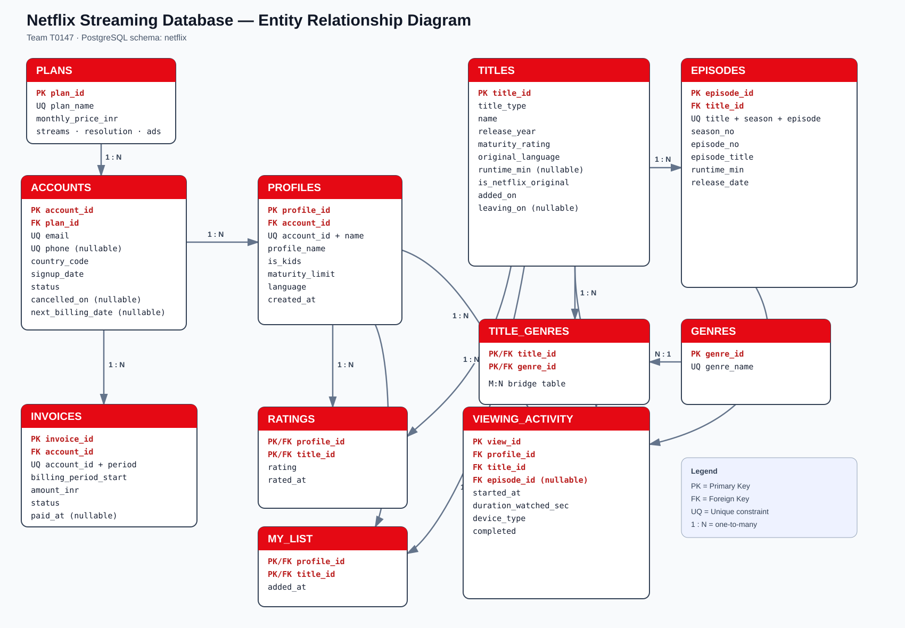
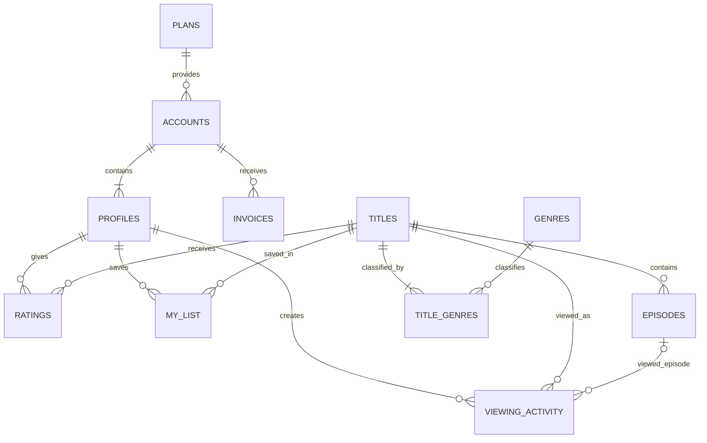

# Phase 2: Schema Design

## 1. Design approach

The schema was derived from the headers, null patterns, distinct values, candidate keys, and relationships in the eleven supplied CSV files. All tables are created in the PostgreSQL schema `netflix`. CP1 contains only integrity constraints; performance indexes are deliberately postponed until Phase 4 so that Phase 3 measures a genuine baseline.

## 2. Entity relationships

### Cardinalities

- One plan can be used by many accounts; each account uses exactly one plan.
- One account contains one to five profiles; every profile belongs to one account.
- One account can receive many monthly invoices.
- One profile can create many viewing records, ratings, and My List entries.
- A movie or series can have many genres and a genre can classify many titles. `title_genres` resolves this M:N relationship.
- A series can contain many episodes; an episode belongs to one series.
- A viewing record belongs to one profile and one title. Its episode is optional because movie views have no episode.
- A profile may rate or save a title at most once, represented by composite keys in `ratings` and `my_list`.

## 3. Data dictionary

Abbreviations: **PK** = primary key, **FK** = foreign key, **UQ** = unique, **NN** = not null.

### `plans` — 4 rows

| Column | PostgreSQL type | Constraints | Reason |
|---|---|---|---|
| `plan_id` | `SMALLINT` | PK | Only four small numeric identifiers exist. |
| `plan_name` | `VARCHAR(10)` | NN, UQ, allowed plan names | A short business code such as `STANDARD`. |
| `monthly_price_inr` | `NUMERIC(8,2)` | NN, positive | Exact currency must not use floating point. |
| `max_streams` | `SMALLINT` | NN, 1–4 | Small whole-number concurrency limit. |
| `max_resolution` | `VARCHAR(5)` | NN, allowed values | Values such as `1080p` contain text. |
| `has_ads` | `BOOLEAN` | NN | True/false plan property. |

### `accounts` — 25,000 rows

| Column | PostgreSQL type | Constraints | Reason |
|---|---|---|---|
| `account_id` | `INTEGER` | PK | Stable account identifier. |
| `email` | `VARCHAR(254)` | NN, UQ, basic email-format check | Login identity; case-insensitive lookup is optimized later. |
| `phone` | `VARCHAR(15)` | UQ, nullable, exactly 10 digits when present | Optional identifier; text preserves formatting/leading zeroes. |
| `country_code` | `CHAR(2)` | NN, two uppercase letters | Fixed two-letter country code. |
| `plan_id` | `SMALLINT` | NN, FK → `plans` | Current subscription plan. |
| `signup_date` | `DATE` | NN | Calendar date, no time needed. |
| `status` | `VARCHAR(10)` | NN, allowed statuses | `ACTIVE`, `ON_HOLD`, or `CANCELLED`. |
| `cancelled_on` | `DATE` | nullable | Present only for cancelled accounts. |
| `next_billing_date` | `DATE` | nullable | Present for active/on-hold accounts, absent after cancellation. |

The status/date checks require cancelled accounts to have `cancelled_on` and no next bill, while active/on-hold accounts require the opposite. A cancellation date cannot precede signup.

### `profiles` — 75,000 rows

| Column | PostgreSQL type | Constraints | Reason |
|---|---|---|---|
| `profile_id` | `INTEGER` | PK | Stable profile identifier. |
| `account_id` | `INTEGER` | NN, FK → `accounts` | Owning account. |
| `profile_name` | `VARCHAR(30)` | NN | User-facing profile name. |
| `is_kids` | `BOOLEAN` | NN | Identifies restricted profiles. |
| `maturity_limit` | `VARCHAR(4)` | NN, allowed ratings | Codes include `U`, `UA7`, `UA13`, `UA16`, `A`. |
| `language` | `VARCHAR(20)` | NN | Profile display language. |
| `created_at` | `TIMESTAMPTZ` | NN | CSV timestamps contain `+05:30`; the instant must be preserved. |

`(account_id, profile_name)` is unique. Kids profiles are restricted to `U` or `UA7`. The maximum-five-profiles rule spans rows and therefore cannot be expressed with a normal `CHECK`; it is verified by an integrity query and would require a trigger or application transaction for strict concurrent enforcement.

### `genres` — 15 rows

| Column | PostgreSQL type | Constraints | Reason |
|---|---|---|---|
| `genre_id` | `SMALLINT` | PK | Small genre identifier. |
| `genre_name` | `VARCHAR(30)` | NN, UQ | Each genre has one unique name. |

### `titles` — 3,000 rows

| Column | PostgreSQL type | Constraints | Reason |
|---|---|---|---|
| `title_id` | `INTEGER` | PK | Stable catalogue identifier. |
| `title_type` | `VARCHAR(6)` | NN, `MOVIE`/`SERIES` | Discriminator for two title types. |
| `name` | `VARCHAR(200)` | NN | Display title; not declared unique because real catalogues can reuse names. |
| `release_year` | `SMALLINT` | NN, sensible range | A year is a small whole number. |
| `maturity_rating` | `VARCHAR(4)` | NN, allowed ratings | Indian maturity code. |
| `original_language` | `VARCHAR(20)` | NN | Language label. |
| `runtime_min` | `SMALLINT` | nullable, 1–600 for movies | Movies have a runtime; series do not. |
| `is_netflix_original` | `BOOLEAN` | NN | Original/licensed flag. |
| `added_on` | `DATE` | NN | Catalogue availability start. |
| `leaving_on` | `DATE` | nullable | Only some licensed titles leave. |

Checks enforce movie/series runtime rules, prevent Originals from having a leaving date, and require any leaving date to be later than `added_on`.

### `title_genres` — 5,963 rows

| Column | PostgreSQL type | Constraints | Reason |
|---|---|---|---|
| `title_id` | `INTEGER` | composite PK, FK → `titles` | One side of the M:N relationship. |
| `genre_id` | `SMALLINT` | composite PK, FK → `genres` | Other side of the M:N relationship. |

The composite PK `(title_id, genre_id)` prevents the same genre being assigned twice to one title.

### `episodes` — 20,000 rows

| Column | PostgreSQL type | Constraints | Reason |
|---|---|---|---|
| `episode_id` | `INTEGER` | PK | Global episode identifier. |
| `title_id` | `INTEGER` | NN, FK → `titles` | Parent series. |
| `season_no` | `SMALLINT` | NN, positive | Small ordinal. |
| `episode_no` | `SMALLINT` | NN, positive | Position within a season. |
| `episode_title` | `VARCHAR(200)` | NN | Episode display name. |
| `runtime_min` | `SMALLINT` | NN, 1–300 | Episode duration in minutes. |
| `release_date` | `DATE` | NN | Episode release day. |

`(title_id, season_no, episode_no)` is unique. `(episode_id, title_id)` is also declared unique so the composite viewing foreign key can prove that a viewed episode belongs to the supplied title.

### `viewing_activity` — 200,401 rows

| Column | PostgreSQL type | Constraints | Reason |
|---|---|---|---|
| `view_id` | `INTEGER` | PK | Viewing-event identifier used by the supplied workload. |
| `profile_id` | `INTEGER` | NN, FK → `profiles` | Viewer. |
| `title_id` | `INTEGER` | NN, FK → `titles` | Movie or parent series. |
| `episode_id` | `INTEGER` | nullable, composite FK with `title_id` | Empty for movie views; present for episode views. |
| `started_at` | `TIMESTAMPTZ` | NN | Exact viewing time with zone. |
| `duration_watched_sec` | `INTEGER` | NN, greater than zero | Whole seconds watched. |
| `device_type` | `VARCHAR(6)` | NN, allowed devices | `TV`, `MOBILE`, `LAPTOP`, or `TABLET`. |
| `completed` | `BOOLEAN` | NN | Stored completion flag used by workload queries. |

### `ratings` — 33,900 rows

| Column | PostgreSQL type | Constraints | Reason |
|---|---|---|---|
| `profile_id` | `INTEGER` | composite PK, FK → `profiles` | Rating author. |
| `title_id` | `INTEGER` | composite PK, FK → `titles` | Rated title. |
| `rating` | `VARCHAR(11)` | NN, allowed values | `THUMBS_DOWN`, `THUMBS_UP`, or `LOVE`. |
| `rated_at` | `TIMESTAMPTZ` | NN | Exact rating time. |

The composite PK means a profile stores at most one current rating per title.

### `my_list` — 59,992 rows

| Column | PostgreSQL type | Constraints | Reason |
|---|---|---|---|
| `profile_id` | `INTEGER` | composite PK, FK → `profiles` | Saving profile. |
| `title_id` | `INTEGER` | composite PK, FK → `titles` | Saved title. |
| `added_at` | `TIMESTAMPTZ` | NN | Exact time saved. |

The composite PK prevents duplicate My List entries.

### `invoices` — 133,057 rows

| Column | PostgreSQL type | Constraints | Reason |
|---|---|---|---|
| `invoice_id` | `INTEGER` | PK | Invoice identifier used by the supplied workload. |
| `account_id` | `INTEGER` | NN, FK → `accounts` | Billed account. |
| `billing_period_start` | `DATE` | NN, first day of month | Monthly billing period. |
| `amount_inr` | `NUMERIC(8,2)` | NN, positive | Historical exact invoice amount. |
| `status` | `VARCHAR(8)` | NN, allowed statuses | `PAID`, `FAILED`, or `REFUNDED`. |
| `paid_at` | `TIMESTAMPTZ` | nullable, status-dependent | Failed invoices have no payment time. |

`(account_id, billing_period_start)` is unique so an account cannot receive two invoices for the same month.

## 4. Foreign-key delete rules

| Relationship | Rule | Justification |
|---|---|---|
| Plan → account | `RESTRICT` | A referenced plan must not disappear while accounts use it. |
| Account → profile | `CASCADE` | Profiles have no independent meaning without their account. |
| Account → invoice | `RESTRICT` | Financial history must not be silently deleted. |
| Title → episode | `RESTRICT` | Prevent removing a title while its episode records exist. |
| Title → title genre | `CASCADE` | Genre assignments have no meaning after their title is removed. |
| Genre → title genre | `RESTRICT` | Prevent deleting a genre that is still assigned. |
| Profile/title → rating or My List | `CASCADE` | These are dependent personalization records. |
| Profile → viewing activity | `CASCADE` | Viewing history is treated as belonging to the profile in this baseline schema. |
| Title/episode → viewing activity | `RESTRICT` | Prevent deleting catalogue records referenced by viewing history. |

No `ON UPDATE` action is specified, so PostgreSQL uses its default `NO ACTION`; identifiers are treated as immutable.

## 5. Functional dependencies and normal forms

| Relation | Candidate key(s) and main functional dependencies | Normal-form conclusion |
|---|---|---|
| `plans` | `plan_id →` all attributes; `plan_name →` all attributes | BCNF |
| `accounts` | `account_id →` all attributes; `email → account_id`; non-null `phone → account_id` | BCNF |
| `profiles` | `profile_id →` all attributes; `(account_id, profile_name) → profile_id` | BCNF |
| `genres` | `genre_id → genre_name`; `genre_name → genre_id` | BCNF |
| `titles` | `title_id →` all other title attributes | BCNF |
| `title_genres` | `(title_id, genre_id)` is the only key and there are no non-key attributes | BCNF |
| `episodes` | `episode_id →` all attributes; `(title_id, season_no, episode_no) → episode_id` | BCNF |
| `viewing_activity` | `view_id →` all other viewing attributes | 3NF/BCNF for stored facts; see redundancy note below |
| `ratings` | `(profile_id, title_id) → rating, rated_at` | BCNF |
| `my_list` | `(profile_id, title_id) → added_at` | BCNF |
| `invoices` | `invoice_id →` all attributes; `(account_id, billing_period_start) → invoice_id, amount_inr, status, paid_at` | BCNF |

All values are atomic (1NF). Junction tables use their complete composite keys, so there are no partial dependencies (2NF). No table stores a non-key attribute that determines another non-key attribute, so there are no transitive dependencies (3NF). The listed determinants are candidate keys, satisfying BCNF under the stated business rules.

## 6. Deliberate redundancy and derived values

- `viewing_activity.completed` can be inferred approximately from watched duration and movie/episode runtime. It is retained because product completion rules can include credits, thresholds, and later edits; storing the decision also makes the fixed workload possible.
- `invoices.amount_inr` may equal the plan price at invoice creation. It must be stored because an invoice is a historical financial fact and must not change when the current plan or price changes.
- `viewing_activity.title_id` is derivable from `episode_id` for series views. It remains necessary for movie rows and avoids repeated episode joins. The composite FK `(episode_id, title_id)` prevents disagreement when an episode exists.

## 7. Nullability findings

- `accounts.phone` is optional: 4,888 rows are empty.
- `cancelled_on` is present only for cancelled accounts; `next_billing_date` is present for active/on-hold accounts.
- `titles.runtime_min` is empty for all 1,000 series and present for all 2,000 movies.
- `titles.leaving_on` is empty for Originals and for licensed titles without a scheduled removal.
- `viewing_activity.episode_id` is empty in 93,056 movie views.
- `invoices.paid_at` is empty for all 4,764 failed invoices and present for paid/refunded invoices.

## 8. Load order and row-count verification

Parents are loaded before children:

`plans → genres → accounts → profiles → titles → title_genres → episodes → viewing_activity → ratings → my_list → invoices`

| Table | Expected | Verified from CSV |
|---|---:|---:|
| plans | 4 | 4 |
| accounts | 25,000 | 25,000 |
| profiles | 75,000 | 75,000 |
| genres | 15 | 15 |
| titles | 3,000 | 3,000 |
| title_genres | 5,963 | 5,963 |
| episodes | 20,000 | 20,000 |
| viewing_activity | 200,401 | 200,401 |
| ratings | 33,900 | 33,900 |
| my_list | 59,992 | 59,992 |
| invoices | 133,057 | 133,057 |

## 9. Integrity-check results

| # | Check | Violations | Interpretation |
|---:|---|---:|---|
| 1 | Each account has at most five profiles | 0 | Pass |
| 2 | No title was watched before it was added | 0 | Pass |
| 3 | A viewed episode belongs to the same series as `title_id` | 0 | Pass |
| 4 | Movie views have no episode; series views have one | 0 | Pass |
| 5 | Only series titles have episodes | 0 | Pass |
| 6 | Watched duration does not exceed the applicable runtime | 0 | Pass |
| 7 | Invoice amount matches the account's current plan price | 0 | Pass for the supplied snapshot |
| 8 | No invoice occurs after account cancellation | 0 | Pass |
| 9 | No profile was created before account signup | 0 | Pass |
| 10 | No viewing occurred before profile creation | **13,097** | Data-quality problem |
| 11 | A completed view reached at least 90% of runtime | 0 | Pass |
| 12 | Kids profiles never watched above their maturity limit | **6,714** | Compliance data found by P6/R14 |

All seed rows load because checks 10 and 12 are cross-row/cross-table business validations rather than row-level constraints in `01_schema.sql`. Check 10 shows that some historical plays predate their profiles and must be reported as a source-data issue. Check 12 is also meaningful project data: R14 is designed to identify these compliance violations rather than assume they cannot exist.

A separate query-level correctness issue exists in R13: `NOT IN` sees nullable movie `episode_id` values and can return an empty result. This is SQL three-valued logic, not corrupted data, and will be corrected with `NOT EXISTS` in Phase 4.

## 10. Baseline indexes

No tuning indexes are created in CP1. PostgreSQL automatically creates indexes for primary keys and unique constraints, including account email/phone, plan and genre names, profile names within an account, episode position within a series, monthly invoice identity, and composite junction keys. Foreign keys do not automatically create indexes in PostgreSQL. Workload-specific B-tree, expression, partial, GIN, BRIN, or covering indexes are reserved for `sql/05_indexes.sql` after baseline measurements.
